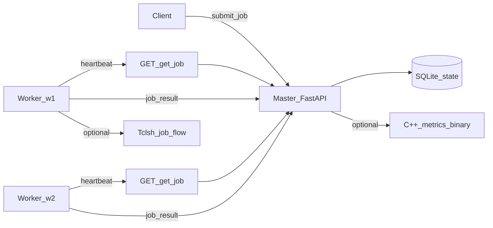
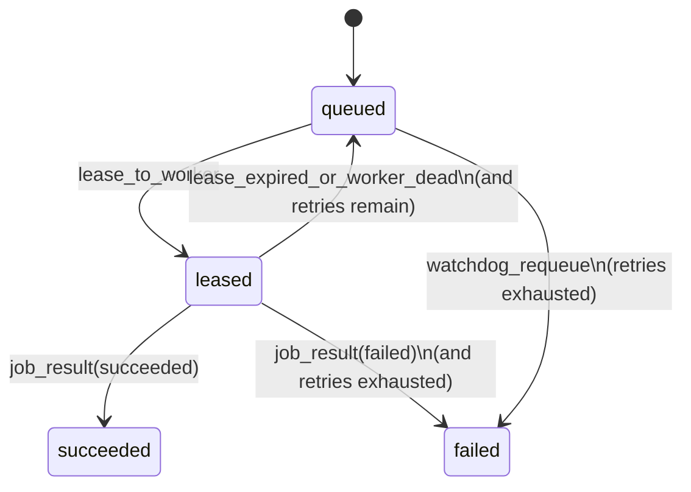

# Distributed Job Scheduler with Fault Tolerance

Python (FastAPI) master + workers, with durable state in SQLite, heartbeat-based failure detection, job leasing + retries, optional TCL job-flow execution, and a C++ metrics CLI.

This project is designed to look and behave like a real scheduler:
- **Durable queue** (SQLite) rather than in-memory state
- **Leases** instead of “fire-and-forget” assignment (prevents lost work)
- **Worker liveness** via heartbeats
- **Automatic requeue + bounded retries**
- **Cross-language hooks** (TCL step runner, C++ metrics)

## High-level architecture (why it’s designed this way)

Schedulers fail in subtle ways: workers crash mid-job, networks partition, clients retry requests, and masters restart. The core design choices here are meant to be the “industry defaults” that prevent lost work and reduce operational surprise.

- **SQLite as source of truth**: job and worker state is durable. A master restart doesn’t erase the queue.
- **Lease-based execution**: the master never assumes a job is “done” just because it was assigned. A lease expires and the job can be safely reassigned.
- **Heartbeats**: liveness is inferred from periodic signals, not from TCP connections (which can lie under partitions).
- **Bounded retries**: you want automation, not infinite loops. Retry budgets prevent runaway clusters.
- **Flow DAG jobs**: CAD/DFT/DFP flows are pipelines with dependencies; supporting DAG steps demonstrates flow orchestration skills.

### Architecture diagram



## Prereqs
- Python **3.12+** (recommended; avoids build issues with native deps on newer Python versions)
- `pyenv` (recommended on macOS if you have multiple Pythons)
- `tclsh` available on PATH (optional; only needed for TCL jobs)
- A C++17 compiler + `make` (optional; only needed for metrics binary)

## Quickstart (step-by-step)

All commands below assume you are in the repo root:

```bash
cd /Users/nallellasiddartha/distributedjobscheduler
```

### 1) Select Python 3.12 (recommended on your machine)

```bash
pyenv local 3.12.6
```

### 2) Create a virtualenv and install dependencies

```bash
rm -rf .venv
pyenv exec python -m venv .venv
source .venv/bin/activate
python -m pip install -r requirements.txt
```

### 3) Build the C++ metrics binary (optional, used by `/status`)

```bash
make -C cpp
```

### 4) Start the master (Terminal 1)

```bash
source .venv/bin/activate
python master/server.py --config config/config.yaml
```

Master listens on `http://127.0.0.1:8000` by default.

### 5) Start workers (separate terminals)

Terminal 2:

```bash
source .venv/bin/activate
python worker/worker.py --config config/config.yaml --worker-id w1
```

Terminal 3:

```bash
source .venv/bin/activate
python worker/worker.py --config config/config.yaml --worker-id w2
```

## API usage

All endpoints require a shared bearer token. The default token is in `config/config.yaml`:
- `master.auth_token`
- `worker.auth_token` (workers must match the master)

### Submit jobs (`POST /submit_job`)

**Compute job example**

```bash
curl -sS -X POST "http://127.0.0.1:8000/submit_job" \
  -H "Authorization: Bearer change-me-dev-token" \
  -H "Content-Type: application/json" \
  -d '{
    "job_type": "compute",
    "priority": "high",
    "retries": 3,
    "payload": { "kind": "simulate" }
  }'
```

**TCL job example** (requires `tclsh`)

```bash
curl -sS -X POST "http://127.0.0.1:8000/submit_job" \
  -H "Authorization: Bearer change-me-dev-token" \
  -H "Content-Type: application/json" \
  -d '{
    "job_type": "io",
    "priority": "medium",
    "retries": 2,
    "payload": { "tcl_script": "tcl/job_flow.tcl" }
  }'
```

### Worker polling (`GET /get_job`)

Workers pull work from the master:
- If a job is available, master responds `200` with a lease and an `attempt_id`.
- If no job is available, master responds `204 No Content`.

You normally don’t call this manually; it’s what `worker/worker.py` does.

### Heartbeats (`POST /heartbeat`)

Workers heartbeat every few seconds so the master can detect failures and requeue work.

### Report results (`POST /job_result`)

Workers post completion/failure results, including execution time and optional stdout/stderr.

### Cluster status + metrics (`GET /status`)

```bash
curl -sS "http://127.0.0.1:8000/status" -H "Authorization: Bearer change-me-dev-token" | python -m json.tool
```

## Example outputs

### Example: `/status` output (truncated)

```json
{
  "now_ms": 1773900550227,
  "job_counts": {
    "succeeded": 2
  },
  "workers": [
    {
      "worker_id": "w1",
      "host": "Nallellas-MacBook-Air",
      "status": "alive",
      "last_heartbeat_at_ms": 1773900550223,
      "in_flight_jobs": 0,
      "metadata": { "pid": 12345 }
    }
  ],
  "cpp_metrics": {
    "total_jobs": 2,
    "success_rate": 1.0,
    "failure_rate": 0.0,
    "avg_execution_time_ms": 2520
  }
}
```

### Example: flow job `stdout` summary (one line JSON)

```json
{
  "flow_results": [
    { "id": "compile", "type": "simulate", "status": "succeeded", "duration_ms": 1003 },
    { "id": "dft_insert", "type": "tcl", "status": "succeeded", "duration_ms": 12 },
    { "id": "dfp_power", "type": "simulate", "status": "succeeded", "duration_ms": 2002 },
    { "id": "signoff", "type": "simulate", "status": "succeeded", "duration_ms": 1001 }
  ]
}
```

### Example: log line (JSONL)

```json
{"ts_ms":1773900483600,"level":"INFO","logger":"worker-w1","msg":"job_received","job_id":"5c83c9e9-af15-48ba-acd7-0cfd13624151","attempt_id":"..."}
```

## Notes on fault tolerance
This system uses a **lease-based** execution model.

- **Lease**: when a worker pulls a job, the master marks it `leased` and sets `lease_expires_at_ms`. The worker must finish and report results before the lease expires.
- **Worker death**: if heartbeats stop for longer than `master.heartbeat_timeout_seconds`, the worker is considered `dead`.
- **Requeue**: the master watchdog periodically requeues jobs that:
  - have an expired lease, or
  - are leased/running on a dead worker.
- **Retries**: each requeue increments `retries_used`. Once `retries_used > retries_max`, the job becomes `failed`.

### Job lifecycle (state machine)



## Flow DAG jobs (CAD/DFT/DFP-style)

In addition to simple one-shot jobs, the scheduler supports a **flow job** (`job_type: "flow"`) whose `payload.flow.steps` is a small DAG.

Each step has:
- `id`: unique step identifier
- `deps`: list of step ids that must complete first
- `type`: `"simulate"` or `"tcl"`
- `sleep_seconds` (optional, simulate only)
- `script` (optional, tcl only; defaults to `payload.tcl_script`)
- `random_failure_rate` (optional, per-step failure injection)

Example flow submission (mix simulate + TCL):

```bash
curl -sS -X POST "http://127.0.0.1:8000/submit_job" \
  -H "Authorization: Bearer change-me-dev-token" \
  -H "Content-Type: application/json" \
  -d '{
    "job_type": "flow",
    "priority": "high",
    "retries": 1,
    "payload": {
      "tcl_script": "tcl/job_flow.tcl",
      "flow": {
        "steps": [
          { "id": "compile", "type": "simulate", "sleep_seconds": 1 },
          { "id": "dft_insert", "type": "tcl", "deps": ["compile"] },
          { "id": "dfp_power", "type": "simulate", "deps": ["compile"], "sleep_seconds": 2 },
          { "id": "signoff", "type": "simulate", "deps": ["dft_insert", "dfp_power"], "sleep_seconds": 1 }
        ]
      }
    }
  }'
```

For a flow job, the worker reports a JSON summary in `stdout` under `flow_results`.

## Operational notes (what recruiters look for)

- **Idempotency & duplicate messages**: workers may retry `job_result` on network errors; the master stores attempts and ignores already-completed attempts.
- **Backpressure & fairness**: workers pull; the master enforces a least-loaded policy by refusing leases to workers that are busier than the cluster minimum.
- **Observability**: logs are structured (JSONL). `/status` returns a quick health view plus C++ computed metrics over recent completed jobs.
- **Extensibility**: adding new job types is localized to `worker/executor.py` and validating payload structure is explicit (flow schema checks, cycle detection).

## Configuration (`config/config.yaml`)

Key settings:
- **master.sqlite_path**: where durable state is stored (default `state/scheduler.db`)
- **master.lease_ttl_seconds**: how long a worker holds a job before it can be reassigned
- **master.heartbeat_timeout_seconds**: worker considered dead after this silence
- **worker.heartbeat_interval_seconds**: heartbeat send interval
- **worker.random_failure_rate**: simulated failure rate (set to `0` for “happy path”)

## Logs

- Master: `logs/master.log`
- Workers: `logs/worker-<id>.log`

Logs are JSON lines and include fields like `job_id`, `worker_id`, and `attempt_id`.

## Tests

```bash
source .venv/bin/activate
pytest -q
```

## Soak test (submit many jobs)

With the master and workers running:

```bash
source .venv/bin/activate
python scripts/soak.py --config config/config.yaml --jobs 50
```

## Troubleshooting

### `ModuleNotFoundError: No module named 'common'`
Run from the repo root. This project also supports direct script runs (`python master/server.py`) by adding the repo root to `sys.path` at runtime.

### `pip install` fails with “externally-managed-environment”
Use a virtualenv (`python -m venv .venv`) and install inside it.

### `/status` has `cpp_metrics: null`
Build the binary:

```bash
make -C cpp
```

Then restart the master so it can find `cpp/metrics`.
